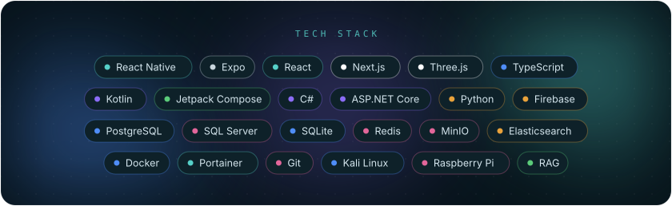
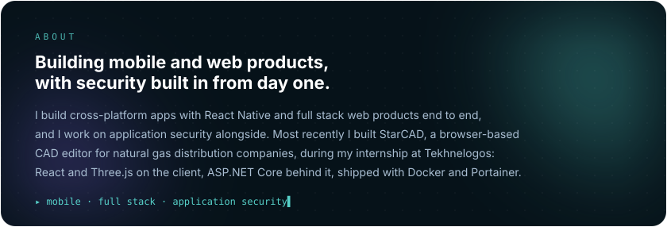
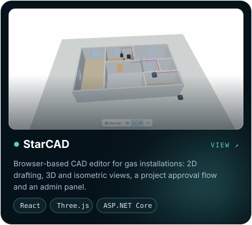
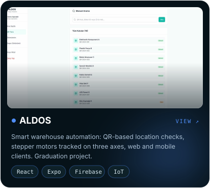
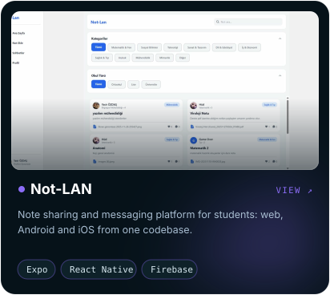
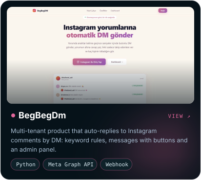
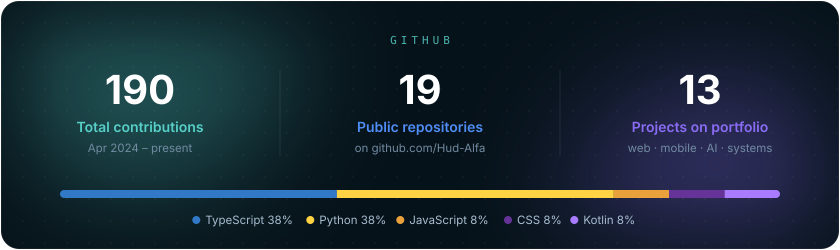
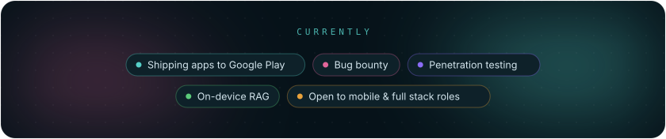

  

  

  

  

  

  
  
  
  

  
    Also: <a href="https://github.com/Hud-Alfa/Su-Vakti">Su-Vakti</a> (Kotlin · Jetpack Compose) ·
    <a href="https://github.com/Hud-Alfa/colon-cancer-detection">Colon Cancer Detection</a> (CNN · ResNet50) ·
    <a href="https://github.com/Hud-Alfa/local-foundry-rag">local-foundry-rag</a> (on-device RAG) ·
    <a href="https://hudalfa.vercel.app">everything on my portfolio →</a>
  

 

  

  

  

  
  
  
  

  

